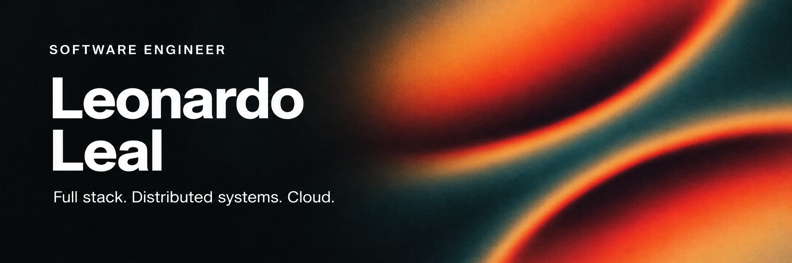
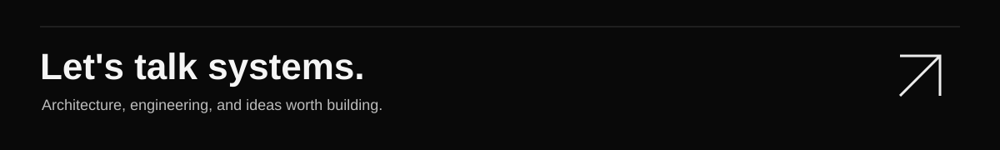

  
  

   
   

  
  
  

   
   

  <a href="#about">ABOUT</a>
  &nbsp; / &nbsp;
  <a href="#toolkit">TOOLKIT</a>
  &nbsp; / &nbsp;
  <a href="#selected-work">SELECTED WORK</a>
  &nbsp; / &nbsp;
  <a href="#activity">ACTIVITY</a>

 

<h2>About</h2>

I'm a software engineer with <strong>Java as my primary language</strong>, building backend services with <strong>Spring Boot and Quarkus</strong> and full-stack applications with <strong>React, Next.js, and TypeScript</strong>. My work centers on distributed systems, software architecture, application security, and cloud infrastructure.

I care about the decisions behind the implementation: how domains are separated, how services communicate, how identity is handled, and how a system can be operated and changed over time.

<table>
  <tr>
    <td width="50%" valign="top">
      <h3>Build &amp; evolve</h3>
      
Full-stack applications, domain-oriented services, asynchronous processing, and cloud infrastructure.

      
<strong>Currently:</strong> building the foundations of <strong>Werant</strong>, with microservices, gRPC, an API gateway / BFF, and domain separation.

    </td>
    <td width="50%" valign="top">
      <h3>Operate &amp; collaborate</h3>
      
Hands-on AWS experience with <strong>EC2, ECS, S3, RDS, and Aurora</strong>, alongside operating <strong>GCP virtual machines</strong> and accessing environments through <strong>SSH and RDP</strong>.

      
Experience with <strong>Keycloak, LDAP, and Microsoft Active Directory</strong>.

      
<strong>Team workflows:</strong> Azure DevOps Boards, Repos, and Pipelines, with Scrum and Kanban.

    </td>
  </tr>
</table>

 

<h2>Technical toolkit</h2>

APPLICATIONS / SYSTEMS / INFRASTRUCTURE / DELIVERY

<table>
  <tr>
    <td width="50%" valign="top">
      01
      <h3>Languages</h3>
      

      

    </td>
    <td width="50%" valign="top">
      02
      <h3>Backend &amp; APIs</h3>
      

      

    </td>
  </tr>
  <tr>
    <td width="50%" valign="top">
      03
      <h3>Frontend &amp; interaction</h3>
      

      

    </td>
    <td width="50%" valign="top">
      04
      <h3>State, forms &amp; data</h3>
      

      

    </td>
  </tr>
  <tr>
    <td width="50%" valign="top">
      05
      <h3>Data &amp; messaging</h3>
      

      

    </td>
    <td width="50%" valign="top">
      06
      <h3>Cloud &amp; systems</h3>
      

      

    </td>
  </tr>
  <tr>
    <td width="50%" valign="top">
      07
      <h3>AWS services</h3>
      

      

    </td>
    <td width="50%" valign="top">
      08
      <h3>Identity &amp; security</h3>
      

      

    </td>
  </tr>
  <tr>
    <td width="50%" valign="top">
      09
      <h3>Delivery &amp; collaboration</h3>
      

      

    </td>
    <td width="50%" valign="top">
      10
      <h3>Architecture &amp; principles</h3>
      

      

    </td>
  </tr>
</table>

  
<strong>More tools I've worked with</strong>

   
  

  

 

<h2>Selected work</h2>

FROM DOMAIN MODELING TO RUNNING SYSTEMS

<table>
  <tr>
    <td width="50%" valign="top">
      DISTRIBUTED SYSTEMS
      <h3>Foundation — Core Services</h3>
      
Backend services organized around business domains, explicit service boundaries, and independent persistence.

      
Domain-driven design · Hexagonal architecture · Event-driven communication · Transactional outbox

      

      

    </td>
    <td width="50%" valign="top">
      IDENTITY &amp; SECURITY
      <h3>Auth Key Rotation</h3>
      
A worker that manages the lifecycle of asymmetric signing keys.

      
RSA-3072 · AES-256-GCM · AWS KMS envelope encryption · Transactional operations

      

      

    </td>
  </tr>
  <tr>
    <td width="50%" valign="top">
      ASYNCHRONOUS PROCESSING
      <h3>Image Processing Worker</h3>
      
An asynchronous image-processing service driven by Kafka events and integrated with object storage.

      
Format validation · Resizing and cropping · JPEG/GIF processing · Object storage

      

      

    </td>
    <td width="50%" valign="top">
      CLOUD INFRASTRUCTURE
      <h3>Foundation Infrastructure</h3>
      
Infrastructure as code for provisioning and managing AWS resources with reproducible configuration.

      
AWS Organizations · Terraform remote state · IAM and OIDC federation · Delivery workflows

      

      

      
<a href="https://github.com/LeonardoNXT/foundation-infrastructure"><strong>Explore repository ↗</strong></a>

    </td>
  </tr>
  <tr>
    <td colspan="2" valign="top">
      FULL-STACK APPLICATION
      <h3>NewArch / FeelSystem</h3>
      
A platform connecting patients, psychologists, and administrators, with role-specific workflows and visual dashboards.

      
React and TypeScript interfaces, Node.js services, MongoDB persistence, JWT authentication, and motion with GSAP and Three.js.

      

      

      
<a href="https://github.com/LeonardoNXT/NewArch"><strong>Explore repository ↗</strong></a>

    </td>
  </tr>
</table>

 

<h2>How I approach engineering</h2>

<blockquote>
  
Good architecture makes the important decisions explicit—and keeps the rest easy to change.

</blockquote>

<strong>Domain first.</strong> Let business rules guide boundaries, contracts, and data ownership.

<strong>Intentional complexity.</strong> Use abstractions and architectural patterns when they solve a concrete problem.

<strong>Security by design.</strong> Consider identity, access, secrets, and key lifecycles as part of the system.

<strong>Repeatable delivery.</strong> Keep infrastructure and delivery workflows versioned, reviewable, and reproducible.

 

<h2>Activity</h2>

  

 
 

  

   
   

  
  

   
   

  LEONARDO LEAL &nbsp; / &nbsp; SOFTWARE ENGINEER

